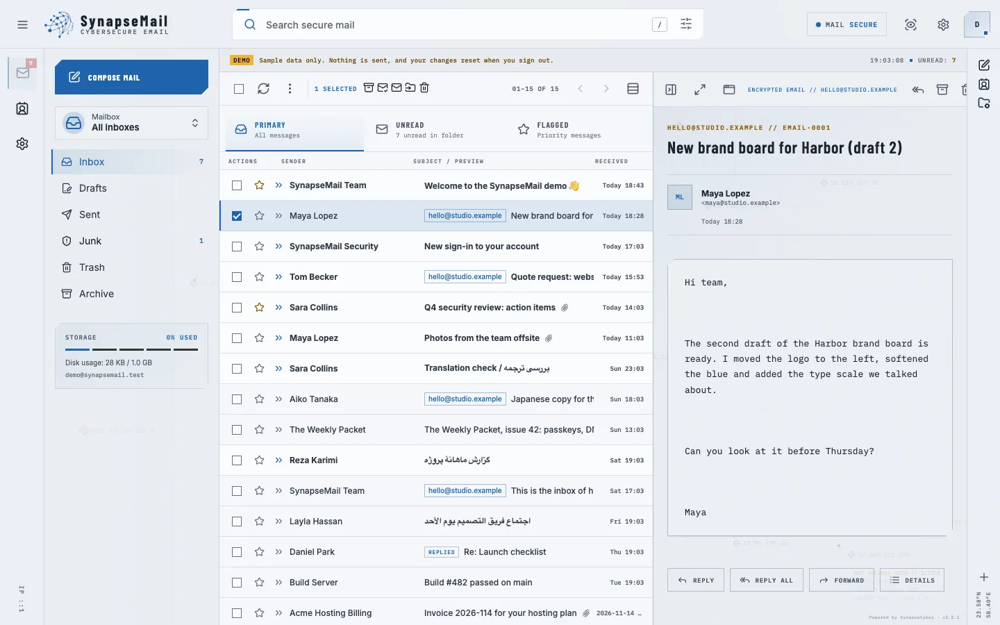
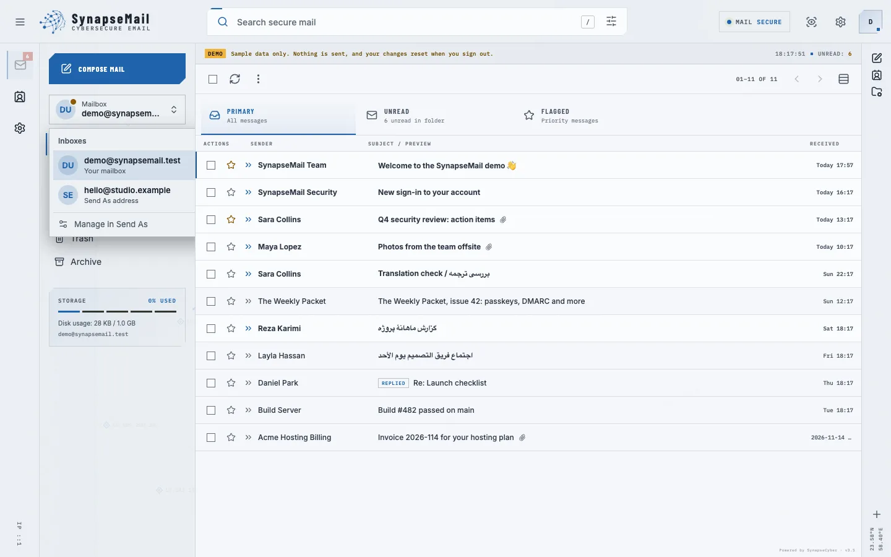
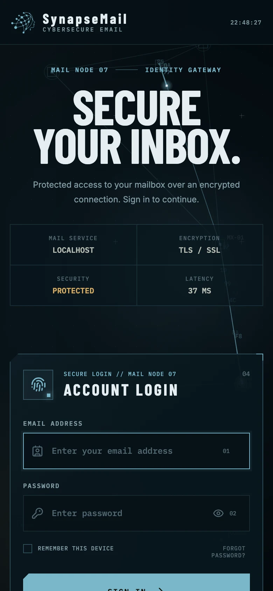
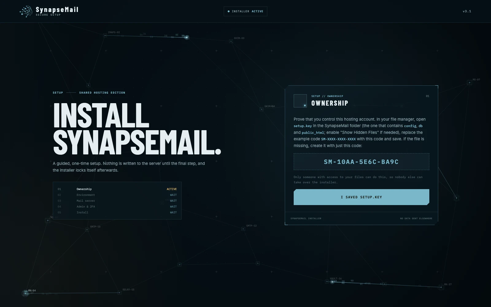
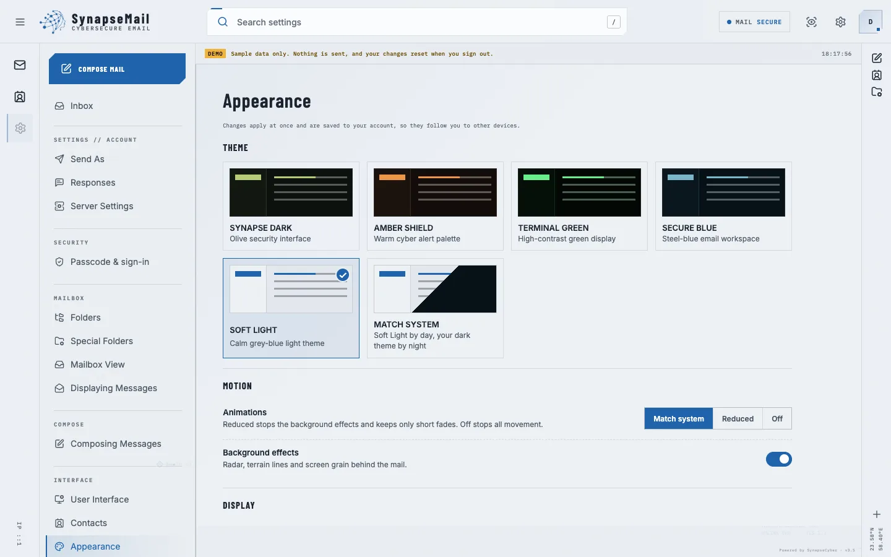
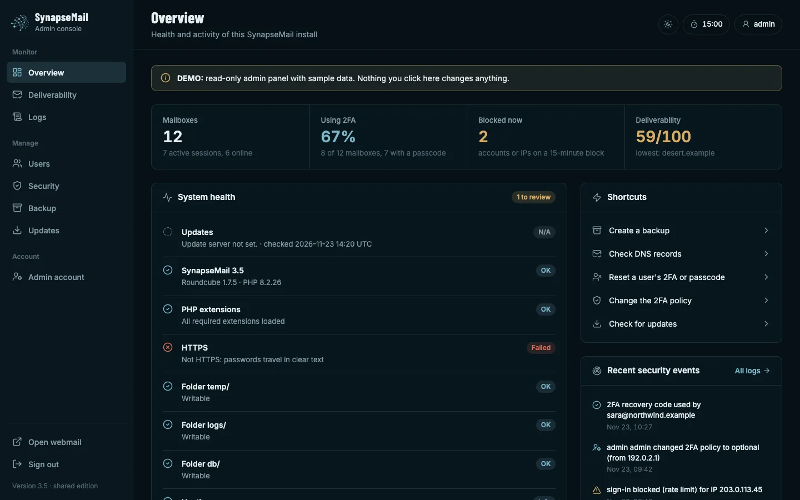
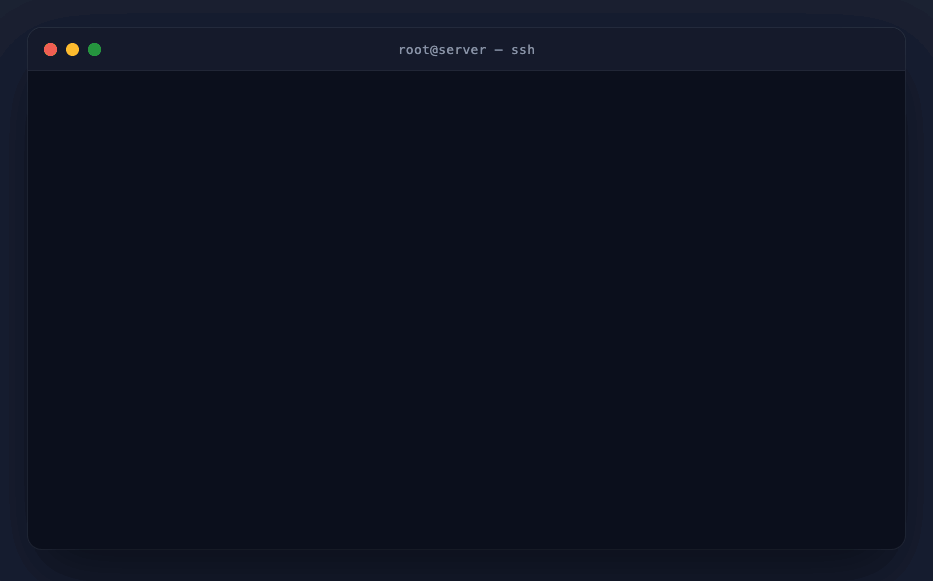

<div align="center">

<a href="https://synapsecyber.io"></a>

# SynapseMail

### 🔐 Secure, self-hosted webmail: 2FA, a passcode lock, every address in one place, and signed one-click updates

**Built on Roundcube 1.7.7 · Works with cPanel, Plesk, DirectAdmin and any IMAP/SMTP mail server**


[✨ New in 3.5.6](#new) · [🚀 Install](#install) · [🐳 Docker](#docker) · [🖥️ WHM](#whm) · [📸 Screenshots](#screenshots) · [🛡️ Security](#security) · [📤 Send As](#send-as) · [📱 Mobile](#mobile) · [🧭 Roadmap](#roadmap) · [❓ FAQ](#faq)


### 🖥️ [Try the live demo →](https://sm-demo.synapsecyber.io)

| | Address | Sign in |
|---|---|---|
| 📬 Webmail | [sm-demo.synapsecyber.io](https://sm-demo.synapsecyber.io) | `demo` / `demo`, 2FA `123456`, passcode `1234` |
| 🧑‍💼 Admin panel | [sm-demo.synapsecyber.io/admin/synapsemail-demo](https://sm-demo.synapsecyber.io/admin/synapsemail-demo) | `admin` / `demo`, 2FA `123456` (read-only) |

Sample data only. No mail server is connected and nothing is sent.

**⭐ If SynapseMail is useful to you, please give it a star. It helps other people find it.**

</div>

---

<a id="new"></a>

## ✨ New in 3.5.6: security update

- 🛡️ **Security fixes** for the compose window, sign-in and two-factor settings, rate limits, Send As and other-inbox
  server tests, and the admin panel. Please update every copy of SynapseMail.
- 🔑 **Confirm it's you:** setting a first passcode or turning on two-factor authentication asks for your mailbox
  password or a current authenticator code.
- 🗄️ **Admin backups** now need your authenticator code, like restore and updates.
- 📦 **Release packages** are built from a clean copy of one version and checked file by file before signing.

<a id="new-355"></a>

## ✨ New in 3.5.5: security update

- 🛡️ **Security fixes** for sign-in, Send As, backups, updates and the Docker image. Please update every copy of
  SynapseMail.
- 🧩 **Roundcube core 1.7.7**, with all security fixes of Roundcube 1.7.6 and 1.7.7.
- 📮 **Send As:** the 6-digit code now always comes from your own mail server, and sending only works from your own
  addresses.

<a id="new-354"></a>
<a id="new-353"></a>

## ✨ New in 3.5.x: send **and read** from every address

| 📥 All your addresses in one inbox | 🔀 Or open one inbox at a time |
|:---:|:---:|
|  |  |

- 🐳 **Official Docker image** for **amd64 and arm64**: `ghcr.io/xcodz/synapsemail`. One command starts it
  ([🐳 Docker](#docker)), and all settings and data stay in one volume.
- 🔐 **Built from the signed release.** GitHub Actions builds every image from the release zip and stops if the
  SynapseCyber signature or any file does not match.
- 🔄 **Simple Docker updates.** Pull the new image and start it again: your settings, users and admin account are kept,
  and the database is updated on start.
- 📥 **All inboxes in one list.** Your inbox shows the mail of all your Send As addresses together, each message
  labeled with the address it came to. The mail stays **on that address's own server**: nothing is copied into your
  main mailbox. Replies come from the right address, and the menu above the folders still opens one inbox at a time.
- ⬆️ **Updates from the admin panel.** Check and install a new version with one click, or upload the release zip.
  Every release is **signed by SynapseCyber**: changed, unsigned or older zips are refused, your settings and data
  are never touched, and the replaced files are kept as a rollback copy.
- 🎨 **Settings › Appearance.** Five themes plus Match system, animations on, reduced or off, background effects, text size, a compact
  list, higher contrast and underlined links. Saved to the account, ready before the page draws.
- 🌤️ **Soft Light theme.** A calm grey-blue light theme, easy on the eyes, for the webmail, the sign-in page and
  the admin panel. **Match system** switches between Soft Light and your dark theme.

📋 [Full changelog](CHANGELOG.md)

---

## 👋 What is SynapseMail?

SynapseMail is a **webmail**: the website where people read and send their email. It connects to the **mail
server you already have**, for example your cPanel or Plesk hosting. You do not need a new mail server and you do
not need a database server.

SynapseMail starts from [Roundcube](https://roundcube.net), the trusted open-source webmail, and adds what
many teams need today: **stronger sign-in security, a modern interface that works well on phones, a smart web
installer and a private admin panel.**

> 💡 **It is not just a theme.** A theme only changes colours. SynapseMail adds a passcode lock, two-factor
> authentication, brute-force protection, device trust, **Send As and the inboxes of all your addresses**, a server
> check before install, an admin panel with backups and **signed updates**, and a new editor for left-to-right and
> right-to-left email.

> ⚠️ **Please read: what 2FA covers today.** The passcode and 2FA protect **the SynapseMail webmail**. They do not
> change your mail server. **IMAP, POP3 and SMTP** (Outlook, Thunderbird, the phone mail app) and **other webmail
> on the same server** (for example the default Roundcube in cPanel) still sign in with **the password only**.
> Closing these doors is the next big step of the project. [Read more](#security-model) · [See the roadmap](#roadmap)

---

## 🆚 Roundcube vs SynapseMail

| | Roundcube (default) | **SynapseMail** |
|---|:---:|:---:|
| Read and send email (IMAP/SMTP) | ✅ | ✅ |
| Modern interface with 5 themes (4 dark + Soft Light) | ➖ | ✅ |
| 🎨 Appearance settings: reduced motion, text size, contrast | ➖ | ✅ |
| Phone and tablet layouts | ✅ | ✅ **redesigned for touch** |
| 🔢 Passcode lock after the password | ❌ | ✅ |
| 📱 Two-factor authentication (TOTP) + recovery codes | plugin needed | ✅ **built in** |
| 🧱 Brute-force lockout for passcode and 2FA | ❌ | ✅ |
| 📤 **Send As**: every address with **its own SMTP server**, proven with a code | ➖ one server only | ✅ **built in** |
| 📥 **All inboxes in one list**: read your other addresses without importing them | ❌ | ✅ |
| 🧷 "Remember this device" with automatic idle sign-out | ➖ | ✅ |
| ✍️ Editor with LTR + RTL in the same email | ➖ | ✅ |
| 🧙 Web installer that checks your hosting panel | basic | ✅ **with fix steps per panel** |
| 🧑‍💼 Admin panel (users, policy, backups) | ❌ | ✅ |
| ⬆️ Signed updates installed from the admin panel | ❌ | ✅ |
| 📊 Email deliverability score (SPF, DKIM, DMARC...) | ❌ | ✅ |
| 🌐 No third-party requests (fonts and icons included) | ✅ | ✅ |

---

<a id="screenshots"></a>

## 📸 Screenshots

**🎬 A quick tour:** sign in → 2FA code → passcode → inbox → RTL email → security settings


| 🔐 Sign in | 📱 On a phone |
|:---:|:---:|
|  |  |

| 🧙 Web installer | 🛠️ Installer help for your hosting |
|:---:|:---:|
|  |  |

| 🎨 Appearance in Soft Light | 🧑‍💼 Admin panel |
|:---:|:---:|
|  |  |

---

<a id="security"></a>

## 🛡️ Sign-in security

Passwords leak. They are reused, guessed or stolen by phishing. SynapseMail adds layers **after** the password,
so a stolen password alone does not open the webmail.

### 🔢 Passcode lock
- A **4 or 6-digit passcode** is asked after the password, like the PIN on your phone.
- Each user chooses **how often**: on every sign-in, or every **3, 7 or 30 days on each device**.
- A **private hint** helps users remember it (the passcode itself is never shown).
- **5 wrong codes** end the session. **10 wrong codes** in a row lock the account for **1 hour**.
- Forgot the passcode? Erasing it **locks the account for 24 hours**, so an attacker cannot simply reset it.

### 📱 Two-factor authentication (2FA)
- **TOTP codes** from Google Authenticator, Microsoft Authenticator, Authy, 1Password and other apps.
- **One-time recovery codes** if the phone is lost.
- An **admin policy**: 2FA off, optional, or **required for everyone**.

### ⏱️ Sessions and devices
- **Idle sign-out:** a normal session ends after **30 minutes without activity**, or when the browser closes.
- **"Remember this device":** a trusted device stays signed in for 15 days and renews while it is used.
- **Rate limits** for each account and each IP address stop password-guessing attacks.
- **Password change** (cPanel) needs the current password, and every attempt is logged.

<a id="security-model"></a>

### 🔍 Honest security model

We think security software must be clear about its limits. Here is exactly what SynapseMail protects today:

| Way to open the mailbox | Password needed | Passcode / 2FA needed |
|---|:---:|:---:|
| 🌐 **SynapseMail webmail** | ✅ | ✅ **yes** |
| 📨 Mail apps over **IMAP / POP3** (Outlook, Thunderbird, phone mail apps) | ✅ | ❌ no |
| 📤 Sending over **SMTP** | ✅ | ❌ no |
| 🧩 **Other webmail** on the same server (for example cPanel's default Roundcube) | ✅ | ❌ no |
| 🖥️ The **hosting panel** itself (cPanel, Plesk, ...) | its own login | its own 2FA settings |

**Why?** SynapseMail is a webmail. It sits in front of your mail server but does not replace it. The mail server
still accepts the password from any app that asks.

**What you can do today:**
- 🔑 Use a **strong, unique password** for every mailbox.
- 🧱 Turn on the protections of your server or panel (for example cPHulk on cPanel, Fail2Ban, or app passwords
  where your mail server supports them).
- 🚫 If you do not use mail apps, ask your host to limit IMAP/POP3/SMTP access, or disable other webmail apps.
- 🖥️ On a WHM server, install the [WHM plugin](#whm) so cPanel's Webmail login opens SynapseMail, where the
  passcode and 2FA apply.

**What comes next:** the **server edition** will let administrators make SynapseMail the only webmail on a server
and work toward protecting the other doors too. See the [roadmap](#roadmap).

---

<a id="send-as"></a>

## 📤 Send As: one webmail for all your addresses

Most people have more than one email address: a work address, a shop or project address, a personal address.
With **Send As** you write from **all of them in SynapseMail**. No more switching between apps and accounts.

- 🧙 **Smart setup wizard**: type the address, and SynapseMail **finds the server settings by itself**. It knows the
  popular mail providers and reads the settings that a domain publishes. You can still change every setting.
- 🔢 **Proven with a code**: your mail server sends a 6-digit code to the new address. Only the real owner can read
  it and add the address, so nobody can send email in somebody else's name.
- 📮 **The right server for every address**: each address sends through **its own SMTP server**, so SPF, DKIM and
  DMARC pass and your email lands in the **inbox, not in spam**.
- ✍️ **A name and a signature for each address**, and one **default address**.
- ↩️ **Smart replies**: a reply comes from the address the message was sent to (or always from your default).
- 📥 **Read their inboxes too**: your inbox shows the mail of all your addresses together, or open one of them from
  the menu above the folders. SynapseMail reads each message **on that address's own server** (IMAP over TLS):
  nothing is copied into your main mailbox, and replies come from the right address automatically.
- 🔐 **Built like a security product**: passwords are encrypted with your install key, they are **only sent over
  TLS**, certificates are checked, private networks are blocked, and every change is logged.
- 🧱 **Clear help when something is wrong**: wrong password, App Password needed, a certificate for another name,
  or a hosting firewall that blocks outgoing mail. SynapseMail tells you what happened and **how to fix it**.
- 🏠 **On your own server**: your addresses, passwords and settings stay with you, not with an outside service.

Works with **any SMTP server**: your hosting mail (cPanel, Plesk, DirectAdmin...), your company mail server and
popular mail providers (App Passwords supported). 📖 [Send As guide](docs/SEND_AS.md)

---

<a id="mobile"></a>

## 📱 Made for phones too

SynapseMail has **separate layouts for desktop, tablet and phone**, not a desktop page made smaller.

- 👆 Big touch targets and simple navigation on small screens
- 📨 Read, write, search and manage folders on the phone
- 🔐 The passcode and 2FA screens are designed for one-hand use
- 🌗 5 themes (4 dark and a calm **Soft Light**), or follow the system, on every device
- 🪟 On desktop: **floating reading windows** and a **command palette** (⌘K / Ctrl+K)

---

## 🎨 Make it yours: Appearance

Settings › Appearance puts the look in the user's hands, and it is saved to the account:

- 🌗 **Theme**: Synapse Dark, Amber Shield, Terminal Green, Secure Blue, **Soft Light**, or **Match system**
- 🎞️ **Animations**: follow the system, reduced (no background effects, short fades only) or off
- 🔠 **Text size** for the message list, the reader and the editor, and a compact message list
- ♿ **Higher contrast** and **underlined links**, so nothing depends on colour alone

---

## ✍️ Writing email in any language

- A rich text editor (built with Lexical) with fonts, text styles and lists
- **Left-to-right and right-to-left in the same email**, set for each paragraph
- Interface in **English, Persian (فارسی) and Arabic (العربية)**; Persian and Arabic use Tahoma by default
- HTML emails are made **easy to read in dark mode automatically**, or shown in their original colours

---

## 🧑‍💼 Admin panel

The admin panel lives at a **private address** (`/admin/<secret-key>`). People without the address see
"404 Not Found". It has its own admin account, and **2FA is required**.

- 🩺 **Health checks**: PHP, folders, HTTPS, mail server connections, hosting panel
- 👥 **Users**: reset a passcode or 2FA, end sessions
- 🔐 **Security policy**: for example, make 2FA required
- 📤 **Send As settings**: turn it on or off, allow reading other inboxes, set the number of addresses, and
  check that your host allows outgoing mail connections
- ⬆️ **Updates**: install a new version with one click, or upload the release zip. Only releases signed by
  SynapseCyber are accepted, every file is checked, your settings and data are kept, and the replaced files
  are saved first
- 📊 **Deliverability score**: MX, PTR, SPF, DKIM, DMARC, TLS and blacklist checks for your domains
- 💾 **Encrypted backup and restore**
- 📜 **Logs** for sign-ins and admin actions

---

<a id="install"></a>

## 🚀 Install in 5 minutes

> 🖥️ Want to look first? Try the [live webmail demo](https://sm-demo.synapsecyber.io) (`demo` / `demo`, 2FA
> `123456`, passcode `1234`) and the read-only [admin panel demo](https://sm-demo.synapsecyber.io/admin/synapsemail-demo)
> (`admin` / `demo`, 2FA `123456`). No mail server is connected.

### 📦 Upload the zip (any PHP hosting)

1. Download `SynapseMail_v<version>.zip` from [Releases](../../releases).
2. Extract it into a folder on your website, for example `public_html/mail`.
3. Open `https://your-domain/mail/` in your browser.
4. Follow the installer. ✅

The installer:
1. asks you to **prove that you own the hosting account** (you put a short code in a file called `setup.key`),
2. **checks your server** and detects your hosting panel,
3. **finds your mail server** (IMAP and SMTP),
4. creates the **admin account with 2FA**,
5. then **locks itself**. 🔒

Full steps: [app/INSTALL-SYNAPSEMAIL.txt](app/INSTALL-SYNAPSEMAIL.txt)

<a id="docker"></a>

### 🐳 Docker (any Linux server, amd64 and arm64)

```bash
docker run -d --name synapsemail --restart unless-stopped -p 127.0.0.1:8080:80 -v synapsemail-data:/data ghcr.io/xcodz/synapsemail:latest
```

Open it (put your HTTPS reverse proxy in front of port 8080), and when the installer shows its code, save it with
`docker exec synapsemail setup-key SM-XXXX-XXXX-XXXX`. Everything else is the same installer. Settings, users and
the admin account live in the `/data` volume; updates are `docker pull` and a new container.

The image is built from the signed release zip: the build checks the signature and every file first. Compose file,
HTTPS, backups and updates: [Docker guide](docker/README.md).

### ✅ Requirements

| Needed | Details |
|---|---|
| 🐘 PHP | 8.1 or newer, with `pdo_sqlite`, `intl`, `mbstring`, `openssl`, `dom` and `xml` |
| 📮 Mail server | any IMAP + SMTP server |
| 🗄️ Database | not needed: SynapseMail uses SQLite (one file) |
| 🔒 HTTPS | strongly recommended (free with Let's Encrypt or AutoSSL) |

### 🧰 Supported hosting panels

The installer **detects your panel** and shows the right steps when something needs fixing, for example a
missing PHP extension or a folder without write permission.

| | | | |
|---|---|---|---|
| ✅ cPanel | ✅ Plesk | ✅ DirectAdmin | ✅ HestiaCP / VestaCP |
| ✅ CloudPanel | ✅ aaPanel | ✅ ISPConfig | ✅ Linux server (no panel) |

🛑 **nginx:** `.htaccess` files do not work on nginx. The installer tests this. If your private folders can be
downloaded, it shows ready nginx rules for your folder and waits until they are in place.

📖 [Troubleshooting](docs/TROUBLESHOOTING.md) · [Steps for each hosting panel](docs/HOSTING-PANELS.md)

---

<a id="whm"></a>

## 🖥️ For WHM servers: send cPanel Webmail to SynapseMail (optional, recommended)

On a cPanel & WHM server, every mailbox also has cPanel's own Webmail (Roundcube on port 2096). That login asks
only for the password, so it skips SynapseMail's passcode and 2FA. The **SynapseMail WHM plugin** sends those
Webmail logins to your SynapseMail address instead, so your users land on the protected webmail and everyone uses
one address. It is optional: SynapseMail works without it, and we recommend it for WHM admins.

```bash
bash <(curl -fsSL https://repo.synapsecyber.io/synapsemail/whm-plugin-only/install.sh)
```

Run it as root on the WHM server. It asks for your SynapseMail address (for example `https://example.com/mail`).



- ➡️ **Every Webmail door:** ports 2095/2096, `webmail.<domain>` and `/webmail` on every site open SynapseMail.
- ✅ **cPanel and WHM logins stay as they are**, and cPanel's own files are never edited.
- 🩺 **Checked before it counts:** after switching, it loads the Webmail, cPanel and WHM logins on the server. If
  anything looks wrong, the original login page comes back by itself.
- 🔄 **Survives cPanel updates:** a cPanel update hook rebuilds it after every update.
- 🧑‍💼 **WHM page:** *Plugins › SynapseMail Webmail* shows the status and has buttons for check, rebuild, restart
  the login service, turn off or on, change the address and update. Uninstall is a separate step you confirm.
- 🔐 **Signed:** the installer checks the SynapseCyber signature of the package before it changes anything.

| Command | What it does |
|---|---|
| `smwhmplugin` | status |
| `smwhmplugin -rollback` | turn it off and restore the original login page (the plugin stays installed) |
| `smwhmplugin -enable` | turn it on again |
| `smwhmplugin -url https://example.com/mail` | change the address |
| `smwhmplugin -update` | install the latest version |
| `smwhmplugin -uninstall` | roll back and remove the plugin |

Needs cPanel & WHM 110 or newer (tested on 138 with AlmaLinux 9) and SynapseMail installed on one of the server's
sites. ⚠️ It is a redirect, not a wall: the *Check Email* button inside cPanel and Webmail sessions that are already
signed in still open cPanel's Webmail, and IMAP, POP3 and SMTP are not changed (see the
[security model](#security-model)).
📖 [WHM plugin guide](whm-plugin/README.md)

| 🧑‍💼 WHM › Plugins › SynapseMail Webmail | 🗑️ Uninstall is a separate step you confirm |
|:---:|:---:|
|  |  |

---

<a id="faq"></a>

## ❓ FAQ

**Is SynapseMail a Roundcube skin or theme?**
No. It includes a new design, but it also adds security features (passcode, 2FA, lockouts, device trust), a web
installer, an admin panel and a new editor. It ships as a complete package based on Roundcube 1.7.7.

**Does it work with cPanel webmail?**
Yes. Install it in a folder of your cPanel account. It connects to the cPanel mail server and can change mailbox
passwords through cPanel.

**Does 2FA also protect IMAP and SMTP?**
Not yet. The passcode and 2FA protect the SynapseMail webmail. Mail apps (IMAP, POP3, SMTP) and other webmail on the
same server still need only the password. See the [Honest security model](#security-model) and the [roadmap](#roadmap).

**Does it work on phones?**
Yes. It has its own phone and tablet layouts, including the passcode and 2FA screens.

**Does it support right-to-left languages?**
Yes. Persian and Arabic are included, and one email can mix LTR and RTL paragraphs.

**Is it free?**
Yes, free to use and share. It is source-available under CC BY-NC-ND 4.0: you cannot sell it or publish
changed versions. See [License](#license).

**Can I send from my other email addresses?**
Yes. Settings › Send As adds any address with its own SMTP server. The wizard finds the settings, a code proves
the address, and each address has its own name and signature. See the [Send As guide](docs/SEND_AS.md).

**Do I need MySQL?**
No. SynapseMail uses SQLite, so there is nothing extra to set up.

**Is there a Docker image?**
Yes: `ghcr.io/xcodz/synapsemail` for amd64 and arm64, built from the signed release zip. See [Docker](#docker).

**Can cPanel's Webmail open SynapseMail instead of Roundcube?**
Yes, on a WHM server. The optional [WHM plugin](#whm) sends the Webmail login (ports 2095/2096,
`webmail.<domain>` and `/webmail`) to your SynapseMail address, and you can roll it back with one command.

---

<a id="roadmap"></a>

## 🧭 The journey: this is only the beginning

SynapseMail 3.x is the **first public release**, not the finished product. It is the base we will build on, step by
step, together with the people who use it. 💪

### ✅ Already here
- Passcode lock, 2FA with recovery codes, lockouts, device trust and idle sign-out
- 📤 Send As: other addresses with their own SMTP server, a setup wizard and a code check
- 📥 All inboxes in one list: read those addresses in SynapseMail, without importing them
- ⬆️ Signed updates installed from the admin panel
- 🎨 Appearance settings and the Soft Light theme
- Modern interface for desktop, tablet and phone, in English, Persian and Arabic
- Web installer with hosting panel detection, and a private admin panel with health checks and backups
- 🖥️ WHM plugin: cPanel's Webmail logins open SynapseMail, with a WHM page, rollback and uninstall
- 🐳 Docker image for amd64 and arm64, built from the signed release

### 🛠️ Next steps (planned)
- ⚡ **One-command installer** for Linux servers and SSH accounts, with signature checks and a terminal interface
- 🖥️ **Server edition for WHM**: install SynapseMail once for the whole server and manage it from WHM, building on
  the WHM plugin, with the option to make SynapseMail the only webmail on the server
- 📦 **Three ways to install**: server edition (WHM), overlay (SynapseMail on top of your own Roundcube) and the
  full package (like today)

### 💭 Ideas we are exploring
- 🔐 Ways to protect **IMAP and SMTP** as well, together with the mail server
- 🗝️ Passkeys and more sign-in options
- 🔑 OAuth sign-in for Send As (no App Password needed)
- 🌍 More languages

Have an idea or a need? [Open an issue](../../issues) and tell us. ⭐ **Star the repository** to follow the journey.

---

## 🔄 Updating

**From the admin panel (3.5 and newer):** open **Admin › Updates**. Click **Check now** and **Install**, or upload
the `SynapseMail_v<version>.zip` from [Releases](../../releases). SynapseMail checks the signature and every file
before it writes anything, keeps your settings and data, and saves the files it replaces in `db/`.

**By hand:** download the zip from [Releases](../../releases) and extract it over your install folder. Your
settings and data are kept.

**Docker:** `docker compose pull && docker compose up -d` (or pull `ghcr.io/xcodz/synapsemail:latest` and start a
new container with the same volume). See the [Docker guide](docker/README.md#updates).

**Coming from 3.4 or older?** Those versions have no Updates page yet, so install 3.5 by hand once. From then on,
updates come from the admin panel.

👀 Tip: on GitHub, choose **Watch › Custom › Releases** to get a message when a new version is out. See the
[changelog](CHANGELOG.md).

---

## 🗂️ Repository layout

| Folder | What is inside |
|---|---|
| `app/` | 📦 the complete package: Roundcube 1.7.7 + SynapseMail ([file list](app/SYNAPSEMAIL-FILES.txt)) |
| `editor/` | ✍️ source code of the email editor (Lexical) |
| `whm-plugin/` | 🖥️ the WHM plugin (`smwhmplugin`): [guide](whm-plugin/README.md) |
| `docker/` | 🐳 the Docker image (`Dockerfile`, `compose.yaml`): [guide](docker/README.md) |
| `tools/` | 🛠️ release build and helper scripts |
| `docs/` | 📖 help, troubleshooting and screenshots |

**🧪 Try it on your computer:** `php -S localhost:8091 -t app/public_html`, then open http://localhost:8091.
Self-test: `php app/plugins/synapse_core/tests/selftest.php`

---

<a id="license"></a>

## 📜 License

SynapseMail is **source-available, not open source**.

- 🟦 **SynapseMail parts** (`skins/synapse`, `plugins/synapse_*`, the installer and admin pages,
  `config/config.inc.php`, `editor/`, `docker/`, `whm-plugin/`, `tools/`):
  [Creative Commons BY-NC-ND 4.0](LICENSE-SYNAPSEMAIL.txt).
  ✅ Use and share it for free, with credit. ❌ Do not sell it or share changed versions.
- 🟩 **Roundcube files** keep their license: GPL-3.0-or-later, with exceptions for skins and plugins. See
  [app/README-ROUNDCUBE.md](app/README-ROUNDCUBE.md).
- 🟨 **Third-party parts:** Lexical (MIT, inside the editor bundle), Lucide icons (ISC), anime.js (MIT),
  qrcode-generator (MIT), fonts (SIL OFL). Details in [LICENSE-SYNAPSEMAIL.txt](LICENSE-SYNAPSEMAIL.txt).

---

## 🤝 Contributing and support

- 🐞 Found a bug or have an idea? [Open an issue](../../issues).
- 🔒 Security problem? Do not open a public issue. Follow [SECURITY.md](SECURITY.md).
- 🚫 Because of the NoDerivatives license, we cannot accept pull requests with code changes.
- ⭐ **Star the repository** to follow new releases and help others find SynapseMail.

---

<div align="center">

<a href="https://synapsecyber.io"></a>

Made with 💙 by **[SynapseCyber.io](https://synapsecyber.io)** · Developed by **Milad Ahmadipour** · Powered by **Roundcube**

Copyright © 2026 SynapseCyber.io

<sub>Keywords: secure webmail, self-hosted webmail, Roundcube alternative, Roundcube 2FA, webmail two-factor authentication,
TOTP, passcode, cPanel webmail, Plesk webmail, DirectAdmin webmail, mobile webmail, responsive webmail, RTL email,
Persian email client, Arabic email client, PHP webmail, IMAP client, send as, multiple email addresses, SMTP per
identity, email aliases, multiple inboxes, read other mailboxes, light theme webmail, accessible webmail, reduced
motion, signed updates, one-click webmail update</sub>

</div>
