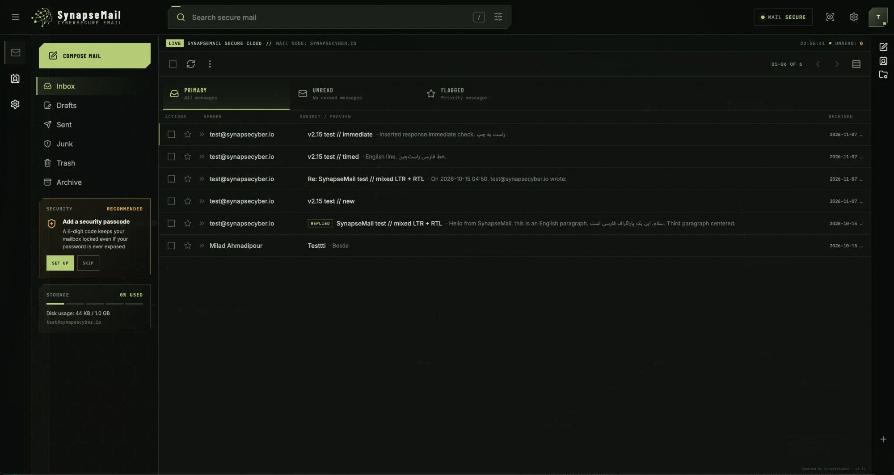
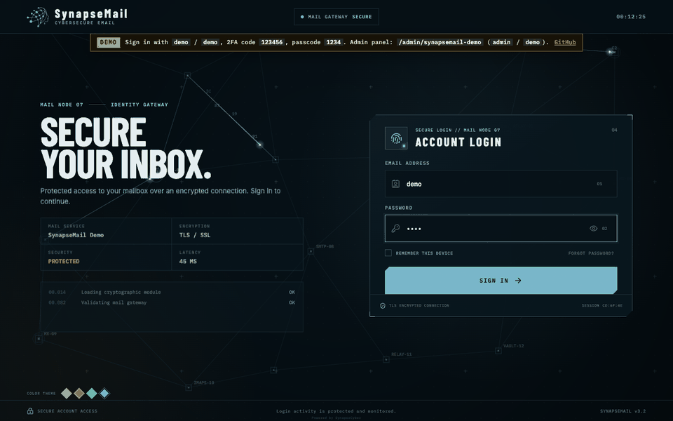
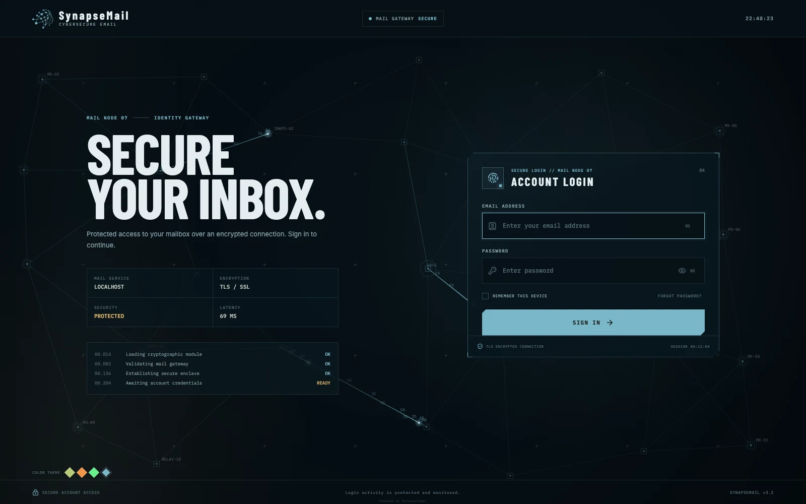
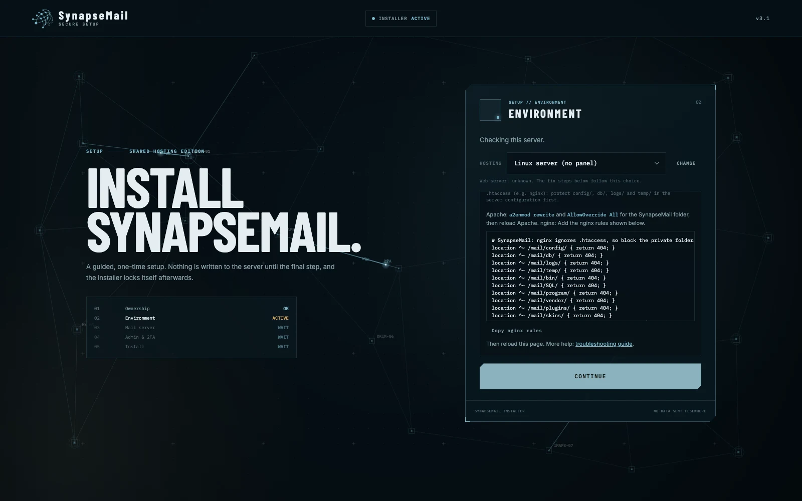

<div align="center">

<a href="https://synapsecyber.io"></a>

# SynapseMail

### 🔐 Secure, self-hosted webmail with 2FA, a passcode lock and a mobile-first design

**Built on Roundcube 1.7 · Works with cPanel, Plesk, DirectAdmin and any IMAP/SMTP mail server**


[🚀 Install](#install) · [📸 Screenshots](#screenshots) · [🛡️ Security](#security) · [📱 Mobile](#mobile) · [🧭 Roadmap](#roadmap) · [❓ FAQ](#faq)



### 🖥️ [Try the live demo →](https://sm-demo.synapsecyber.io)

| | Address | Sign in |
|---|---|---|
| 📬 Webmail | [sm-demo.synapsecyber.io](https://sm-demo.synapsecyber.io) | `demo` / `demo`, 2FA `123456`, passcode `1234` |
| 🧑‍💼 Admin panel | [sm-demo.synapsecyber.io/admin/synapsemail-demo](https://sm-demo.synapsecyber.io/admin/synapsemail-demo) | `admin` / `demo`, 2FA `123456` (read-only) |

Sample data only. No mail server is connected and nothing is sent.

**⭐ If SynapseMail is useful to you, please give it a star. It helps other people find it.**

</div>

---

## 👋 What is SynapseMail?

SynapseMail is a **webmail**: the website where people read and send their email. It connects to the **mail
server you already have**, for example your cPanel or Plesk hosting. You do not need a new mail server and you do
not need a database server.

SynapseMail starts from [Roundcube](https://roundcube.net), the trusted open-source webmail, and adds what
many teams need today: **stronger sign-in security, a modern interface that works well on phones, a smart web
installer and a private admin panel.**

> 💡 **It is not just a theme.** A theme only changes colours. SynapseMail adds a passcode lock, two-factor
> authentication, brute-force protection, device trust, a server check before install, an admin panel with
> backups and signed updates, and a new editor for left-to-right and right-to-left email.

> ⚠️ **Please read: what 2FA covers today.** The passcode and 2FA protect **the SynapseMail webmail**. They do not
> change your mail server. **IMAP, POP3 and SMTP** (Outlook, Thunderbird, the phone mail app) and **other webmail
> on the same server** (for example the default Roundcube in cPanel) still sign in with **the password only**.
> Closing these doors is the next big step of the project. [Read more](#security-model) · [See the roadmap](#roadmap)

---

## 🆚 Roundcube vs SynapseMail

| | Roundcube (default) | **SynapseMail** |
|---|:---:|:---:|
| Read and send email (IMAP/SMTP) | ✅ | ✅ |
| Modern interface with 4 colour themes | ➖ | ✅ |
| Phone and tablet layouts | ✅ | ✅ **redesigned for touch** |
| 🔢 Passcode lock after the password | ❌ | ✅ |
| 📱 Two-factor authentication (TOTP) + recovery codes | plugin needed | ✅ **built in** |
| 🧱 Brute-force lockout for passcode and 2FA | ❌ | ✅ |
| 🧷 "Remember this device" with automatic idle sign-out | ➖ | ✅ |
| ✍️ Editor with LTR + RTL in the same email | ➖ | ✅ |
| 🧙 Web installer that checks your hosting panel | basic | ✅ **with fix steps per panel** |
| 🧑‍💼 Admin panel (users, policy, backups, updates) | ❌ | ✅ |
| 📊 Email deliverability score (SPF, DKIM, DMARC...) | ❌ | ✅ |
| ✍️ Signed updates (Ed25519) | ❌ | ✅ |
| 🌐 No third-party requests (fonts and icons included) | ✅ | ✅ |

---

<a id="screenshots"></a>

## 📸 Screenshots

**🎬 A quick tour:** sign in → 2FA code → passcode → inbox → RTL email → security settings



| 🔐 Sign in | 📱 On a phone |
|:---:|:---:|
|  |  |

| 🧙 Web installer | 🛠️ Installer help for your hosting |
|:---:|:---:|
|  |  |

---

<a id="security"></a>

## 🛡️ Sign-in security

Passwords leak. They are reused, guessed or stolen by phishing. SynapseMail adds layers **after** the password,
so a stolen password alone does not open the webmail.

### 🔢 Passcode lock
- A **4 or 6-digit passcode** is asked after the password, like the PIN on your phone.
- Each user chooses **how often**: on every sign-in, or every **3, 7 or 30 days on each device**.
- A **private hint** helps users remember it (the passcode itself is never shown).
- **5 wrong codes** end the session. **10 wrong codes** in a row lock the account for **1 hour**.
- Forgot the passcode? Erasing it **locks the account for 24 hours**, so an attacker cannot simply reset it.

### 📱 Two-factor authentication (2FA)
- **TOTP codes** from Google Authenticator, Microsoft Authenticator, Authy, 1Password and other apps.
- **One-time recovery codes** if the phone is lost.
- An **admin policy**: 2FA off, optional, or **required for everyone**.

### ⏱️ Sessions and devices
- **Idle sign-out:** a normal session ends after **30 minutes without activity**, or when the browser closes.
- **"Remember this device":** a trusted device stays signed in for 15 days and renews while it is used.
- **Rate limits** for each account and each IP address stop password-guessing attacks.
- **Password change** (cPanel) needs the current password, and every attempt is logged.

<a id="security-model"></a>

### 🔍 Honest security model

We think security software must be clear about its limits. Here is exactly what SynapseMail protects today:

| Way to open the mailbox | Password needed | Passcode / 2FA needed |
|---|:---:|:---:|
| 🌐 **SynapseMail webmail** | ✅ | ✅ **yes** |
| 📨 Mail apps over **IMAP / POP3** (Outlook, Thunderbird, phone mail apps) | ✅ | ❌ no |
| 📤 Sending over **SMTP** | ✅ | ❌ no |
| 🧩 **Other webmail** on the same server (for example cPanel's default Roundcube) | ✅ | ❌ no |
| 🖥️ The **hosting panel** itself (cPanel, Plesk, ...) | its own login | its own 2FA settings |

**Why?** SynapseMail is a webmail. It sits in front of your mail server but does not replace it. The mail server
still accepts the password from any app that asks.

**What you can do today:**
- 🔑 Use a **strong, unique password** for every mailbox.
- 🧱 Turn on the protections of your server or panel (for example cPHulk on cPanel, Fail2Ban, or app passwords
  where your mail server supports them).
- 🚫 If you do not use mail apps, ask your host to limit IMAP/POP3/SMTP access, or disable other webmail apps.

**What comes next:** the **server edition** will let administrators make SynapseMail the only webmail on a server
and work toward protecting the other doors too. See the [roadmap](#roadmap).

---

<a id="mobile"></a>

## 📱 Made for phones too

SynapseMail has **separate layouts for desktop, tablet and phone**, not a desktop page made smaller.

- 👆 Big touch targets and simple navigation on small screens
- 📨 Read, write, search and manage folders on the phone
- 🔐 The passcode and 2FA screens are designed for one-hand use
- 🌗 4 colour themes, which follow you on every device
- 🪟 On desktop: **floating reading windows** and a **command palette** (⌘K / Ctrl+K)

---

## ✍️ Writing email in any language

- A rich text editor (built with Lexical) with fonts, text styles and lists
- **Left-to-right and right-to-left in the same email**, set for each paragraph
- Interface in **English, Persian (فارسی) and Arabic (العربية)**; Persian and Arabic use Tahoma by default
- HTML emails are made **easy to read in dark mode automatically**, or shown in their original colours

---

## 🧑‍💼 Admin panel

The admin panel lives at a **private address** (`/admin/<secret-key>`). People without the address see
"404 Not Found". It has its own admin account, and **2FA is required**.

- 🩺 **Health checks**: PHP, folders, HTTPS, mail server connections, hosting panel
- 👥 **Users**: reset a passcode or 2FA, end sessions
- 🔐 **Security policy**: for example, make 2FA required
- 📊 **Deliverability score**: MX, PTR, SPF, DKIM, DMARC, TLS and blacklist checks for your domains
- 💾 **Encrypted backup and restore**
- ⬆️ **Signed update checks**: a new version is shown only if its Ed25519 signature is valid
- 📜 **Logs** for sign-ins and admin actions

---

<a id="install"></a>

## 🚀 Install in 5 minutes

> 🖥️ Want to look first? Try the [live webmail demo](https://sm-demo.synapsecyber.io) (`demo` / `demo`, 2FA
> `123456`, passcode `1234`) and the read-only [admin panel demo](https://sm-demo.synapsecyber.io/admin/synapsemail-demo)
> (`admin` / `demo`, 2FA `123456`). No mail server is connected.

### 📦 Upload the zip (any PHP hosting)

1. Download `SynapseMail_v<version>.zip` from [Releases](../../releases).
2. Extract it into a folder on your website, for example `public_html/mail`.
3. Open `https://your-domain/mail/` in your browser.
4. Follow the installer. ✅

The installer:
1. asks you to **prove that you own the hosting account** (you put a short code in a file called `setup.key`),
2. **checks your server** and detects your hosting panel,
3. **finds your mail server** (IMAP and SMTP),
4. creates the **admin account with 2FA**,
5. then **locks itself**. 🔒

Full steps: [app/INSTALL-SYNAPSEMAIL.txt](app/INSTALL-SYNAPSEMAIL.txt)

### ⚡ One command (Linux server or SSH) *coming in the next release*

```bash
bash <(curl -fsSL https://repo.synapsecyber.io/synapsemail)
```

It will check the release signature before it installs anything.

### ✅ Requirements

| Needed | Details |
|---|---|
| 🐘 PHP | 8.1 or newer, with `pdo_sqlite`, `intl`, `mbstring`, `openssl`, `dom` and `xml` |
| 📮 Mail server | any IMAP + SMTP server |
| 🗄️ Database | not needed: SynapseMail uses SQLite (one file) |
| 🔒 HTTPS | strongly recommended (free with Let's Encrypt or AutoSSL) |

### 🧰 Supported hosting panels

The installer **detects your panel** and shows the right steps when something needs fixing, for example a
missing PHP extension or a folder without write permission.

| | | | |
|---|---|---|---|
| ✅ cPanel | ✅ Plesk | ✅ DirectAdmin | ✅ HestiaCP / VestaCP |
| ✅ CloudPanel | ✅ aaPanel | ✅ ISPConfig | ✅ Linux server (no panel) |

🛑 **nginx:** `.htaccess` files do not work on nginx. The installer tests this. If your private folders can be
downloaded, it shows ready nginx rules for your folder and waits until they are in place.

📖 [Troubleshooting](docs/TROUBLESHOOTING.md) · [Steps for each hosting panel](docs/HOSTING-PANELS.md)

---

<a id="faq"></a>

## ❓ FAQ

**Is SynapseMail a Roundcube skin or theme?**
No. It includes a new design, but it also adds security features (passcode, 2FA, lockouts, device trust), a web
installer, an admin panel and a new editor. It ships as a complete package based on Roundcube 1.7.5.

**Does it work with cPanel webmail?**
Yes. Install it in a folder of your cPanel account. It connects to the cPanel mail server and can change mailbox
passwords through cPanel.

**Does 2FA also protect IMAP and SMTP?**
Not yet. The passcode and 2FA protect the SynapseMail webmail. Mail apps (IMAP, POP3, SMTP) and other webmail on the
same server still need only the password. See the [Honest security model](#security-model) and the [roadmap](#roadmap).

**Does it work on phones?**
Yes. It has its own phone and tablet layouts, including the passcode and 2FA screens.

**Does it support right-to-left languages?**
Yes. Persian and Arabic are included, and one email can mix LTR and RTL paragraphs.

**Is it free?**
Yes, free to use and share. It is source-available under CC BY-NC-ND 4.0: you cannot sell it or publish
changed versions. See [License](#license).

**Do I need MySQL?**
No. SynapseMail uses SQLite, so there is nothing extra to set up.

---

<a id="roadmap"></a>

## 🧭 The journey: this is only the beginning

SynapseMail 3.x is the **first public release**, not the finished product. It is the base we will build on, step by
step, together with the people who use it. 💪

### ✅ Already here
- Passcode lock, 2FA with recovery codes, lockouts, device trust and idle sign-out
- Modern interface for desktop, tablet and phone, in English, Persian and Arabic
- Web installer with hosting panel detection, and an admin panel with signed updates

### 🛠️ Next steps (planned)
- ⚡ **One-command installer** for Linux servers and SSH accounts, with signature checks and a terminal interface
- 🖥️ **Server edition for WHM**: install once for the whole server and manage it from WHM, with the option to make
  SynapseMail the only webmail on the server
- 📦 **Three ways to install**: server edition (WHM), overlay (SynapseMail on top of your own Roundcube) and the
  full package (like today)

### 💭 Ideas we are exploring
- 🔐 Ways to protect **IMAP and SMTP** as well, together with the mail server
- 🗝️ Passkeys and more sign-in options
- 🌍 More languages

Have an idea or a need? [Open an issue](../../issues) and tell us. ⭐ **Star the repository** to follow the journey.

---

## 🔄 Updating

Extract the new zip over your install folder. Your settings and data are kept. The admin panel tells you when a
new **signed** version is available. See the [changelog](CHANGELOG.md).

---

## 🗂️ Repository layout

| Folder | What is inside |
|---|---|
| `app/` | 📦 the complete package: Roundcube 1.7.5 + SynapseMail ([file list](app/SYNAPSEMAIL-FILES.txt)) |
| `editor/` | ✍️ source code of the email editor (Lexical) |
| `installer/` | ⚡ the one-command installer (next release) |
| `repo-site/` | 🌐 the download website |
| `tools/` | 🛠️ release build and helper scripts |
| `docs/` | 📖 help, troubleshooting and screenshots |

**🧪 Try it on your computer:** `php -S localhost:8091 -t app/public_html`, then open http://localhost:8091.
Self-test: `php app/plugins/synapse_core/tests/selftest.php`

---

<a id="license"></a>

## 📜 License

SynapseMail is **source-available, not open source**.

- 🟦 **SynapseMail parts** (`skins/synapse`, `plugins/synapse_*`, the installer and admin pages,
  `config/config.inc.php`, `editor/`, `installer/`, `repo-site/`, `tools/`):
  [Creative Commons BY-NC-ND 4.0](LICENSE-SYNAPSEMAIL.txt).
  ✅ Use and share it for free, with credit. ❌ Do not sell it or share changed versions.
- 🟩 **Roundcube files** keep their GPL-3.0 license. See [app/README-ROUNDCUBE.md](app/README-ROUNDCUBE.md).
- 🟨 **Third-party parts:** Lexical (MIT), Lucide icons (ISC), anime.js (MIT), qrcode-generator (MIT), fonts
  (SIL OFL). Details in [LICENSE-SYNAPSEMAIL.txt](LICENSE-SYNAPSEMAIL.txt).

---

## 🤝 Contributing and support

- 🐞 Found a bug or have an idea? [Open an issue](../../issues).
- 🔒 Security problem? Do not open a public issue. Follow [SECURITY.md](SECURITY.md).
- 🚫 Because of the NoDerivatives license, we cannot accept pull requests with code changes.
- ⭐ **Star the repository** to follow new releases and help others find SynapseMail.

---

<div align="center">

<a href="https://synapsecyber.io"></a>

Made with 💙 by **[SynapseCyber.io](https://synapsecyber.io)** · Developed by **Milad Ahmadipour** · Powered by **Roundcube**

Copyright © 2026 SynapseCyber.io

<sub>Keywords: secure webmail, self-hosted webmail, Roundcube alternative, Roundcube 2FA, webmail two-factor authentication,
TOTP, passcode, cPanel webmail, Plesk webmail, DirectAdmin webmail, mobile webmail, responsive webmail, RTL email,
Persian email client, Arabic email client, PHP webmail, IMAP client</sub>

</div>
