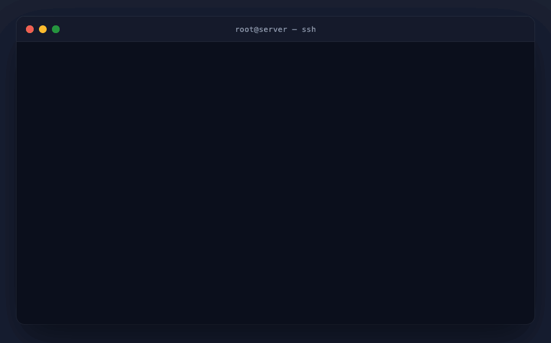
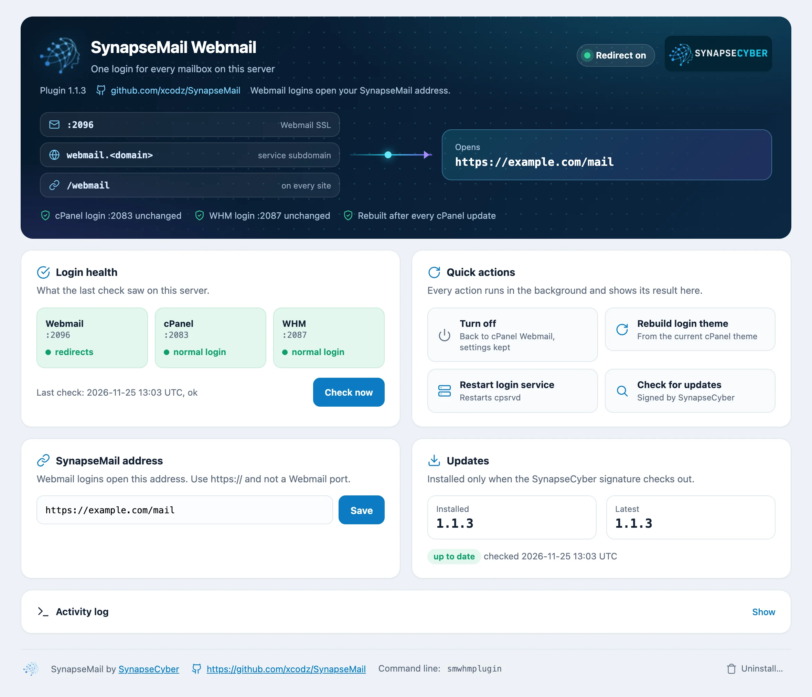
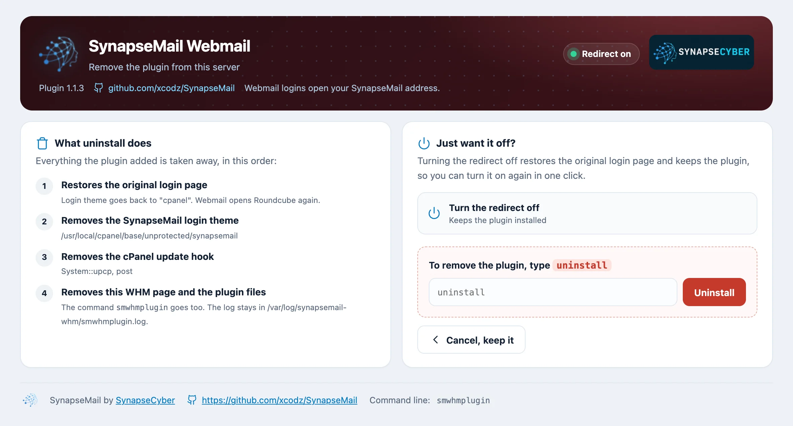

# SynapseMail WHM plugin (smwhmplugin)

Sends the cPanel Webmail login to your SynapseMail address, on the whole server:
ports 2095/2096, `webmail.<domain>` and `domain/webmail` all open the address you choose (for example
`https://example.com/mail`). cPanel (2083) and WHM (2087) logins are not changed. Everything can be rolled back.

Tested target: cPanel & WHM 11.138 on AlmaLinux 9 (bash 5.1, OpenSSL 3). Needs cPanel 110 or newer.

## Install (as root on the WHM server)

```bash
bash <(curl -fsSL https://repo.synapsecyber.io/synapsemail/whm-plugin-only/install.sh)
```

Options: `--url https://example.com/mail`, `-y` (no questions), `--plain` (no full-screen view), `NO_COLOR=1`.



## WHM page

After the install, **WHM >> Plugins >> SynapseMail Webmail** shows the status and has buttons for: check now,
rebuild the login theme, restart the login service (cpsrvd), turn the redirect off or on, change the address,
check for updates and update, and the activity log. Uninstall is a separate step (the small "Uninstall…" link at
the bottom): it lists what will be removed, offers "turn the redirect off" instead, and only runs after you type
`uninstall`. Only WHM users with the `all` privilege
(root) can open it. Buttons are POST only, from a fixed list, with a same-origin check on top of WHM's session
token, and they run `smwhmplugin` in the background (so a cpsrvd restart cannot cut them off).





## Commands

| Command | What it does |
|---|---|
| `smwhmplugin` | status |
| `smwhmplugin -url URL` | change the SynapseMail address |
| `smwhmplugin -check` | check that Webmail redirects and cPanel/WHM logins are normal |
| `smwhmplugin -repair` | rebuild the login theme (runs by itself after every cPanel update) |
| `smwhmplugin -rollback` | turn the redirect off and restore the original login page (also `-disable`, `-off`) |
| `smwhmplugin -enable` | turn it on again |
| `smwhmplugin -uninstall` | roll back and remove the plugin (`-y` skips the question) |
| `smwhmplugin -update` | install the latest version from the repo (signature checked, never older) |
| `smwhmplugin -latest` | check which version is the latest (signature checked) |
| `smwhmplugin -restart` | restart cPanel's login service (cpsrvd) |
| `smwhmplugin -json` | status as JSON (used by the WHM page) |

## How it works

1. **Login theme copy.** cPanel shows the same login theme on cPanel, WHM and Webmail, and its templates know
   which one is open (`app_name` is `webmaild` for Webmail). The plugin copies the server's current login theme
   (WHM >> Theme Manager >> Login) to `/usr/local/cpanel/base/unprotected/synapsemail/` and adds one block at the
   top of `templates/login.tmpl`, shown only when `app_name == 'webmaild'`: a meta refresh, `location.replace()` and
   a visible link. The stock theme is never edited.
2. **Activation.** `whmapi1 set_tweaksetting key=default_login_theme value=synapsemail` (Tweak Settings >> Default
   login theme). The previous theme is saved and restored on rollback.
3. **Health check.** It loads the logins on 127.0.0.1:2096, :2083 and :2087. Webmail must show the redirect,
   cPanel and WHM must show the theme without it. If the template is not served (for example cPanel falls back to
   its legacy login page), the check restarts cpsrvd once and tries again, then switches back to the original theme.
4. **cPanel updates.** A Standardized Hook (`System`, `upcp`, `post`) runs `smwhmplugin -repair` after every update:
   the copy is rebuilt from the updated original theme and checked again. If the check fails, the original login
   page comes back and `smwhmplugin` shows "paused" until `smwhmplugin -enable`.

## Files

| Path | What |
|---|---|
| `/usr/local/synapsemail-whm/` | the plugin (`smwhmplugin`, `lib/ui.sh`, `hooks/postupcp`) |
| `/usr/local/sbin/smwhmplugin` | link to the command |
| `/etc/synapsemail-whm/config` | the SynapseMail address (root only) |
| `/var/lib/synapsemail-whm/state` | original theme, on/off, last check (root only), plus a copy of `cpanel.config` from before the change |
| `/var/log/synapsemail-whm/smwhmplugin.log` | log (kept after uninstall) |
| `/usr/local/cpanel/base/unprotected/synapsemail/` | the login theme copy (removed on rollback) |
| `/usr/local/cpanel/whostmgr/docroot/cgi/synapsemail/index.cgi` | the WHM page (restored by the update hook if an update removes it) |
| `/usr/local/cpanel/whostmgr/docroot/addon_plugins/synapsemail.png` | its icon (SynapseCyber logo) |
| `/var/cpanel/apps/synapsemail.conf` | its AppConfig entry (`register_appconfig` / `unregister_appconfig`) |
| `/var/cpanel/hooks/` | the update hook entry, added and removed with `manage_hooks` |

## Safety

- The package is checked before anything changes: SHA-256 against `SHA256SUMS`, and `SHA256SUMS` against its
  Ed25519 signature with the SynapseCyber release key pinned in `install.sh` (the key that signs SynapseMail
  updates). Archive entries must be plain files and folders under `smwhmplugin/`.
- `smwhmplugin -update` checks the same signed `SHA256SUMS` before it runs the new `install.sh`, which must match
  it. An older version is never installed by an update; to go back on purpose, run `install.sh --downgrade`.
- The WHM page accepts changes only from WHM itself: the browser must name this server as the page that sent them.
- The address must be `https://`, without quotes, spaces, `?`, a Webmail port or a `webmail.` host (no loops).
- One run at a time (`flock /run/smwhmplugin.lock`, a folder only root can write); the update hook waits up to two minutes for it.
- This is a convenience redirect, not a security boundary: a browser without JavaScript and meta refresh, a
  signed-in Webmail session, or cPanel's "Check Email" button still reach cPanel Webmail. IMAP/POP3/SMTP are
  unchanged.

## Building and testing

`tools/build_whm_plugin.sh` builds `dist/whm-plugin-only/` (upload its contents to
`https://repo.synapsecyber.io/synapsemail/whm-plugin-only/`) and `dist/whm-plugin-only.zip`. It needs the release
signing key in `~/.synapsemail/release-signing.key` (never in git).

It builds from a clean snapshot of one commit (default `HEAD`), never from the working folder, and refuses a dirty
tree. Before signing it checks that the payload holds exactly the files in `whm-plugin/PAYLOAD-FILES.txt`, with no
per-install files, databases, backups, development folders, key blocks, tokens or private host patterns. The
archive is reproducible: two builds of one commit give the same bytes. `tools/test-release-build.sh` tests these
rules with a throwaway key.

## License

The WHM plugin is part of SynapseMail and is source-available, not open source: it is under
[Creative Commons BY-NC-ND 4.0](../LICENSE-SYNAPSEMAIL.txt). Use and share it for free, with credit, but do not sell
it or share changed versions. The SynapseMail it installs comes with its own license notices
(`LICENSE-SYNAPSEMAIL.txt`, and Roundcube's GPL-3.0-or-later with exceptions for skins and plugins).
